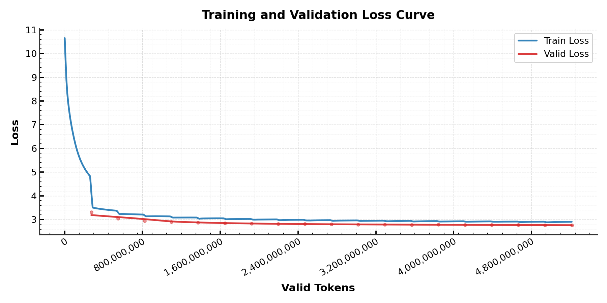

# Transformer 复现（WMT14 EN-DE）

从零实现的《Attention Is All You Need》(Vaswani et al., 2017) base 模型，
在 WMT 2014 英德翻译任务上复现论文结果。

| | 论文 base | 本实现                       |
|---|---|---------------------------|
| 参数量 | 65 M | **63.05 M**（weight tying） |
| dev BLEU (newstest2013) | 25.8 | **25.42**（intl 分词）        |
| dev PPL | 4.92 | 5.07                      |

---

## 1. 环境

```
Python 3.9
torch 2.8 (CUDA)
tokenizers 0.22
sacrebleu 2.6
numpy / tqdm
```

```bash
pip install -r requirements.txt
```

单卡 RTX 3060 (12 GB) 上：batch=8、max_len=400 时显存峰值约 **5.7 GB**，
吞吐约 **6 k token/s**；A100 级别单卡约 **24.6 k token/s**。

---

## 2. 快速开始

```bash
# ① 准备语料（见第 6 节，从网盘下载后放到 data/wmt14_en_de/）
# ② 训练共享 BPE 词表（约 10 分钟）
python scripts/train_bpe.py

# ③ 训练（5B token）
python train.py --config config.yaml

# ④ 评测
python evaluate.py --ckpt checkpoint/xxx/last_model.pth --split test --beam 4
```

---

## 3. 结果

| 数据集 | 论文| 13a（我） | intl 分词（我） | 
|---|---|--------|------------|
| newstest2013 (dev) | **25.8** | 24.76  | **25.42**  | 

- 上表为 **5B token** 的单个 checkpoint，beam=4，length penalty 0.6，
  `max_len = 源句长 + 50`。

---

## 4. 关键设计说明

### 4.1 梯度累积：`if pending >= TOKENS_PER_STEP`

论文 §5.1：

> Each training batch contained a set of sentence pairs containing
> approximately **25000 source tokens and 25000 target tokens**.

论文 §5.2：

> We trained the base models for a total of **100,000 steps** or 12 hours.

论文的一个 step 约 **5 万 token**（25k 源 + 25k 目标）。
单张 12 GB 卡装不下 5 万 token的Batch，
所以实现里把它拆成若干 micro-batch，**攒够 5 万 token 才更新一次参数**：

```python
current_token = (src_ids != 0).sum() + (target_ids != 0).sum()   # 不含 <pad>
pending += current_token

scaler.scale(l * (current_token / TOKENS_PER_STEP)).backward()

if pending >= TOKENS_PER_STEP:            # 攒够 5 万 token
    pending = 0
    lr = noam.step(...)                   
    scaler.step(optimizer)                
    scaler.update()
    optimizer.zero_grad()
```


### 4.2 BPE 的空格与 `</w>`

`scripts/train_bpe.py` 的配置：

```python
tok = Tokenizer(models.BPE(unk_token="<unk>"))
tok.pre_tokenizer = pre_tokenizers.Whitespace()      # 只在空格处预切分
tok.decoder = decoders.BPEDecoder()                  # 解码时按 </w> 补空格
tok.train(..., end_of_word_suffix="</w>")            # 词尾标记
```

`</w>` 是 Sennrich 式 BPE 的词尾标记（论文 §5.1 引用的正是该工作）。
它带来两个后果，都在评测时处理：

1. **词表里每个词的最后一个子词带 `</w>`**，例如
   `Resumption` → `["Res", "um", "ption</w>"]`。这保证了子词能正确拼回单词。
2. **解码时每个 `</w>` 后补一个空格**，于是标点、撇号前面会多出空格：

   | 原始文本 | `tok.decode()` 的结果 |
   |---|---|
   | `Gutach: Noch` | `Gutach : Noch` |
   | `Gutacht's` | `Gutacht ' s` |
   | `33-Fußgängerampel` | `33 - Fußgängerampel` |


`evaluate.py` 里的 `detok()` 还原：

```python
标点前空格     ",.;:!?%)]}»”"
开括号后空格    "([{«„“"
缩写撇号        word ' s/t/d/m/re/ve/ll → word's
斜杠            " / " → "/"
数字连字符      "33 - xxx" → "33-xxx"
```


### 4.3 长度限制，以及「把最长的桶放在最前面」

**为什么要限制长度**

显存峰值近似为

```
peak ≈ 1.05(GPU系统占用) + 0.00074·(B·L) + 8e-7·(B·L²)     单位 GB，L = 单侧最长 token 数
```

`L²` 来自注意力机制，训练集里有一句 **15,155 token** ，Batch_Size = 8 就是 `8 × 15155`，直接 OOM。

`utils/dataset.py` 在构建索引时按 `max_seq_len` 过滤：

```python
if len(src.tokens) > max_seq_len or len(tgt.tokens) > max_seq_len:
    continue
```

代价很小：

```
被过滤    512 句对 (样本 0.011%)
占 token  0.332%
```

**为什么把最长的桶故意放在最前面**

分桶后，索引按「src+tgt 总长」升序排列，然后每 16 条切一块（块内长度相近）。
最后一块必然是全语料最长的 16 条。采样器把它**换到第一个位置**：

```python
starts = list(range(0, full, 16))
random.shuffle(starts)
max_index = starts.index(max(starts) - 16)
starts[max_index], starts[0] = starts[0], starts[max_index]
```

由于PyTorch 的缓存分配器的特点
如果最大的批出现在训练中途，那一刻需要向驱动申请显存段，
而池子里已有的小块又都拼不出这么大的连续空间——显存会突然冲高。

把最长的一批安排在**第一步**，等于让分配器一开始就把「最坏情况」的显存块要下来，
后续所有小批都从这块里切。实测效果：

| | 峰值 reserved |
|---|---|
| 不做预热（最大批在中途出现） | 11.6 GB（接近 OOM） |
| 预热后 | **5.7 GB 稳态** |

---

## 5. 项目结构

```
Transformer_Replication/
├── train.py                    # 训练入口（读 config.yaml）
├── evaluate.py                 # BLEU 评测（贪心 / beam search）
├── config.yaml                 # 全部超参
├── requirements.txt
│
├── Transformer/
│   ├── model.py                # Encoder-Decoder 组装、weight tying
│   └── component.py            # MultiHeadAttention / FFN / PE / Embedding / LN
│
├── utils/
│   ├── dataset.py              # Dataset（长度过滤+排序）、BucketBatchSampler、collate_fn
│   ├── loss.py                 # label smoothing 交叉熵
│   └── train_tools.py          # NoamLR（论文 §5.3）、优化器构造
│
├── scripts/
│   ├── download_wmt14.py       # 从 statmt.org 下载并整理 WMT14 en-de（推荐从网盘获取完整数据集）
│   └── train_bpe.py            # 训练 37k 共享 BPE 词表
│
├── data/wmt14_en_de/
│   ├── train.{en,de}           # 4,508,785 句对
│   ├── valid.{en,de}           # newstest2013，3,000 句
│   ├── test.{en,de}            # newstest2014，3,003 句
│   └── bpe37k_shared.json      # 共享 BPE 词表
│
├── checkpoint/                 # 训练输出
└── valid_ids_cache.pkl         # 训练集长度索引缓存（可删除，会自动重建）
```

---

## 6. 数据集

WMT14 en-de 原始语料可从 <https://www.statmt.org/wmt14/translation-task.html> 下载，
也可以用 `scripts/download_wmt14.py` 自动完成（europarl v7 + commoncrawl + nc-v9）。

**直接下载整理好的版本（百度网盘）**
```
链接: https://pan.baidu.com/s/19eOLfgIBlkiMf2PSjRVnFQ?pwd=7qms 
提取码：7qms
```

下载后把 `wmt14_en_de/` 整个目录放到项目下，保持如下结构：

```
data/
└── wmt14_en_de/
    ├── train.en  train.de      # 599 MB / 670 MB
    ├── valid.en  valid.de      # 326 KB / 377 KB
    ├── test.en   test.de       # 352 KB / 391 KB
    └── bpe37k_shared.json      # 37,000 词表
```


如果只想先跑通流程，可以只下 `valid.*` 和 `test.*`，然后用
`python scripts/train_bpe.py --max-lines 200000` 训一个小词表试跑。

---
## 7. 待改进
- 评测使用多个 checkpoint 的权重平均
- 解码端加 KV cache
- 补充端侧导出部署
---

## 参考

Vaswani, A., et al. "Attention Is All You Need." NeurIPS 2017.
<https://arxiv.org/abs/1706.03762>
